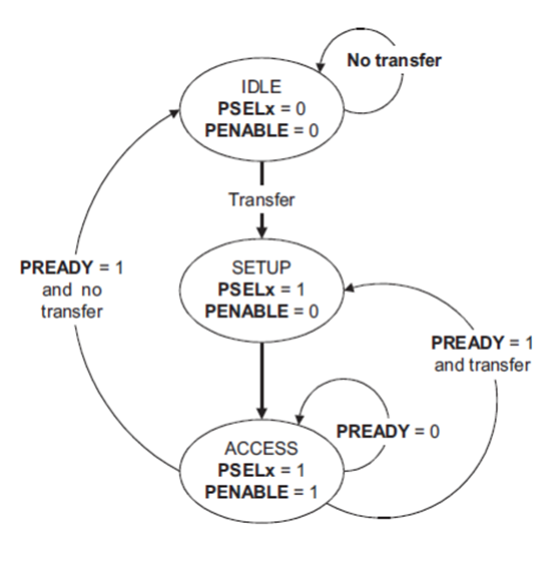

# APB Slave Verification using UVM

A UVM-based verification environment for an AMBA APB slave design, written in SystemVerilog.

## Description
This project verifies an APB slave DUT using a UVM testbench with master and slave agents, monitors, a scoreboard, and protocol assertions.

## AMBA APB (Advanced Peripheral Bus)

AMBA APB (Advanced Peripheral Bus) is a low-power, low-latency bus protocol used in the AMBA (Advanced Microcontroller Bus Architecture) system.

- It is primarily designed for connecting low-speed peripherals such as timers, UARTs, and GPIOs to the high-performance system bus.
- APB is simpler compared to AXI and AHB, with non-pipelined transfers that take a minimum of two clock cycles (SETUP and ACCESS) and minimal power consumption.

## Signal Description

| Signal | Source | Description |
|---|---|---|
| `PCLK` | Clock | PCLK is a clock signal. All APB signals are timed against the rising edge of PCLK. |
| `PRESETn` | System bus reset | PRESETn is the reset signal and is active-LOW. PRESETn is normally connected directly to the system bus reset signal. |
| `PADDR` | Master | PADDR is the APB address bus. |
| `PPROT` | Master | Protection type. |
| `PSELx` | Master | The Master generates a PSELx signal for each Slave. PSELx indicates that the Slave is selected and that a data transfer is required. |
| `PENABLE` | Master | PENABLE indicates the second and subsequent cycles of an APB transfer. |
| `PWRITE` | Master | PWRITE indicates an APB write access when HIGH and an APB read access when LOW. |
| `PWDATA` | Master | The PWDATA write data bus is driven by the APB bridge Master during write cycles when PWRITE is HIGH. |
| `PSTRB` | Master | PSTRB indicates which byte lanes to update during a write transfer. There is one write strobe for each 8 bits of the write data bus. PSTRB must not be active during a read transfer. |
| `PREADY` | Slave | PREADY is used to extend an APB transfer by the Slave. |
| `PSLVERR` | Slave | Transfer error. PSLVERR is an optional signal that can be asserted HIGH by the Slave to indicate an error condition on an APB transfer. |
| `PRDATA` | Slave | The PRDATA read data bus is driven by the selected Slave during read cycles when PWRITE is LOW. |

## Operating States



- **IDLE state:** the default state.
- **SETUP state:** entered when `PSELx` is asserted. The interface remains in the SETUP state for only one clock cycle and always moves to the ACCESS state on the next rising edge of the clock.
- **ACCESS state:** entered when `PENABLE` is asserted. The signals `PADDR`, `PPROT`, `PWRITE`, `PWDATA` (only for write transactions) and `PSTRB` must not change in the transition between SETUP and ACCESS, and between cycles in the ACCESS state.
- Exit from the ACCESS state is controlled by the `PREADY` signal from the Slave:
  - Stay in the ACCESS state if `PREADY` is LOW.
  - Go to the IDLE state if `PREADY` is HIGH and there is no more data.
  - Go to the SETUP state if `PREADY` is HIGH and more data is pending.

## Repository Structure

```
├── APB_Slave_DUT/
│   └── design.sv        # APB slave design
└── UVM_TB/
    ├── testbench.sv     # Top module
    ├── apb_pkg.sv       # Package
    ├── apb_config.sv    # Configuration class
    ├── apb_trans.sv     # Transaction (sequence item)
    ├── apb_seq.sv       # Sequence
    ├── apb_seqr.sv      # Sequencer
    ├── apb_drv.sv       # Driver
    ├── m_agent.sv       # Master agent
    ├── s_agent.sv       # Slave agent
    ├── apb_m_mon.sv     # Master monitor
    ├── apb_s_mon.sv     # Slave monitor
    ├── apb_sb.sv        # Scoreboard
    ├── apb_env.sv       # Environment
    ├── apb_test.sv      # Test
    └── prop_mod.sv      # Assertions / properties
```
